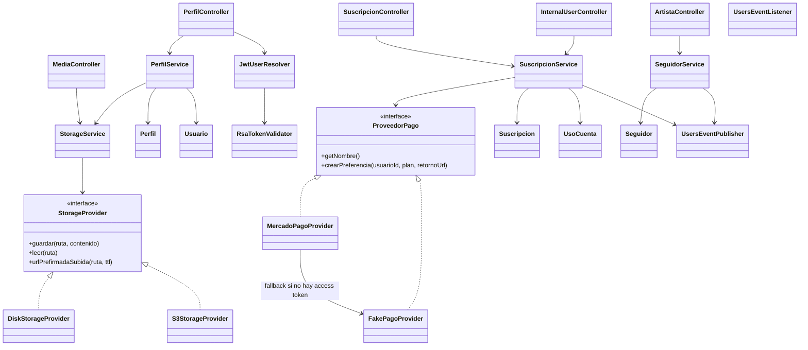
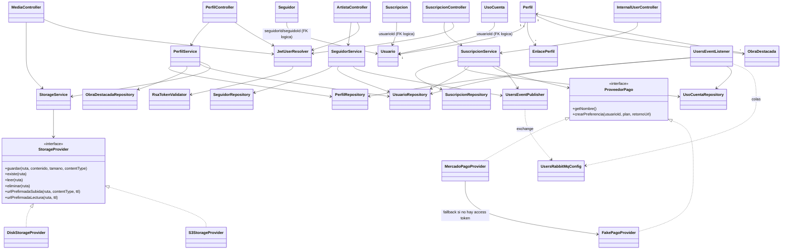

# artagram-users

Microservicio de Gestión de Usuarios, Perfiles Artísticos, Seguidores, Cuotas y Suscripciones para ArtaGram.

## Descripción del servicio

`artagram-users` es el microservicio responsable del perfil artístico de cada
usuario dentro de ArtaGram: biografía, foto, enlaces, obras destacadas, el
grafo de seguidores, y (por ahora) el control de cuotas y suscripciones de
pago (plan GRATIS vs PRO). Existe como servicio separado de `artagram-auth`
porque su dominio es distinto: auth solo se encarga de identidad, credenciales
y emisión/validación de JWT, mientras que `artagram-users` modela "ser
artista en la plataforma" (perfil, seguidores, plan). En vez de llamar
síncronamente a auth en cada request, `artagram-users` mantiene su propia
copia local de `Usuario` y la sincroniza de forma asíncrona consumiendo los
eventos `user.registered`/`user.deleted` publicados por auth vía RabbitMQ, y
valida el JWT localmente con la llave pública RSA (`RsaTokenValidator`). La
lógica de pagos (MercadoPago/Fake) vive hoy dentro de este mismo servicio por
simplicidad del curso, aunque el plan a mediano plazo es extraerla a un
servicio `artagram-billing` independiente.

## Responsabilidades

- Exponer y actualizar el perfil artístico propio y público (biografía, foto,
  enlaces, obras destacadas) — `PerfilController` / `PerfilService`.
- Resolver al usuario autenticado a partir del JWT RS256 emitido por
  `artagram-auth`, validándolo localmente con la llave pública
  (`JwtUserResolver` + `RsaTokenValidator`), sin necesidad de llamar a auth.
- Gestionar el grafo de seguidores (seguir/dejar de seguir, conteo de
  seguidores) — `SeguidorService`, publicando `follow.created`/`follow.deleted`.
- Sincronizar su copia local de usuarios con `artagram-auth` de forma
  asíncrona vía RabbitMQ, consumiendo `user.registered` y `user.deleted`
  (`UsersEventListener`) en lugar de ser consultado síncronamente.
- Administrar cuotas de uso por plan (megabytes y número de obras subidas) —
  entidad `UsoCuenta`.
- Procesar suscripciones y pagos: generar checkout, confirmar pago aprobado y
  activar el plan PRO — `SuscripcionService` + `ProveedorPago`
  (`MercadoPagoProvider`/`FakePagoProvider`), publicando
  `subscription.updated`.
- Subir y servir archivos multimedia (avatares, portadas, obras) a S3 (o a
  disco en entornos locales) mediante `StorageProvider`/`StorageService`,
  incluyendo URLs prefirmadas de subida y lectura.
- Exponer un endpoint interno (`GET /internal/users/{id}/plan`) para que
  otros servicios consulten el plan de un usuario sin duplicar la lógica de
  negocio de suscripciones.
- Registrar y exponer KPIs/métricas de negocio para los dashboards técnico y
  de negocio (paquete `kpi`).

## Tecnologías
- Java 21, Spring Boot 3.3.4
- Spring Data JPA + PostgreSQL (`db_usuarios`)
- Spring AMQP (RabbitMQ: publica `follow.created`, `follow.deleted`, `subscription.updated`; consume `user.registered`, `user.deleted`)
- Validación de JWT RS256 con llave pública RSA
- Integración de pagos (MercadoPago / Fake)
- AWS SDK v2 para fotos de perfil / avatars

## Endpoints
- `GET /api/perfil/me`
- `PUT /api/perfil/me`
- `GET /api/perfiles/{nombreArtista}`
- `POST /api/artistas/{id}/seguir`
- `GET /api/artistas/{id}`
- `GET /api/suscripcion/actual`
- `POST /api/suscripcion/checkout`
- `POST /api/suscripcion/confirmar`
- `GET /internal/users/{id}/plan`
- `POST /api/media/presign`
- `GET /media/**`

## Variables de Entorno
Ver `.env.example`.

## Diseño y Arquitectura

Arquitectura en capas clásica (Controller → Service → Repository), con dos
puntos de extensión reales resueltos por interfaz + inyección de
dependencias: almacenamiento de archivos (`StorageProvider`) y pasarela de
pagos (`ProveedorPago`). Los controladores son delgados: resuelven el
usuario autenticado vía `JwtUserResolver` y delegan toda la lógica a su
service correspondiente.

### Evaluación SOLID

- **SRP (bien resuelto):** cada service tiene una sola razón de cambio —
  `PerfilService` solo perfil/obras destacadas, `SeguidorService` solo el
  grafo de seguidores, `SuscripcionService` solo plan/cuota/pago,
  `StorageService` solo resolución de rutas/URLs. Los controladores no
  tienen lógica de negocio, solo mapean HTTP → service.
- **OCP / DIP (el punto fuerte del servicio):** `StorageProvider` y
  `ProveedorPago` son interfaces reales inyectadas por constructor; agregar
  un proveedor nuevo (p. ej. Azure Blob o Stripe) no requiere tocar
  `StorageService` ni `SuscripcionService`, solo implementar la interfaz y
  registrar el bean. Esto es Open/Closed e Inversión de Dependencias
  aplicados correctamente, no solo en el papel.
- **OCP (mejorable):** `MercadoPagoProvider` no es una estrategia pura —
  internamente decide si delega a `FakePagoProvider` según si hay
  `access-token` configurado, en vez de que Spring elija el bean correcto
  vía `@ConditionalOnProperty`/perfiles. Funciona, pero mezclar la
  implementación "real" con el fallback en la misma clase hace que agregar
  un tercer proveedor implique tocar esta clase, no solo añadir una nueva.
  También `SuscripcionService.procesarPagoAprobado` fija los límites del
  plan PRO con literales (`5120`, `500`) en el método: pasar a un enum/tabla
  `Plan` sería más abierto a nuevos niveles sin editar el service.
- **LSP:** sin violaciones observadas — ambas implementaciones de
  `StorageProvider` y `ProveedorPago` son sustituibles sin que el llamador
  conozca cuál está activa.
- **ISP:** `StorageProvider` usa métodos `default` para las URLs
  prefirmadas (`urlPrefirmadaSubida/Lectura`), así `DiskStorageProvider` no
  está obligado a implementar algo que no soporta. Buen uso de ISP vía
  defaults en lugar de forzar una interfaz más chica aparte.

### Preparación para AWS

- **Base de datos:** `db_usuarios` en PostgreSQL → migrar a **RDS for
  PostgreSQL** (o Aurora PostgreSQL si se busca failover automático). Las
  variables `DB_HOST/DB_PORT/DB_NAME/DB_USER/DB_PASSWORD` ya están
  externalizadas, solo hay que apuntarlas al endpoint de RDS.
- **Secretos:** `artagram.pago.mercadopago-access-token` y las credenciales
  de DB deben ir a **AWS Secrets Manager** (o Parameter Store si el costo
  importa más que la rotación automática), nunca a variables de entorno en
  texto plano en la definición de la tarea de ECS/EKS.
- **Almacenamiento:** `S3StorageProvider` ya habla el protocolo S3 nativo
  (hoy contra MinIO); apuntar `S3_ENDPOINT` a `s3.amazonaws.com` (o quitar
  el endpoint custom y dejar que el SDK resuelva la región) es el único
  cambio necesario — no hace falta tocar código.
- **Escalado horizontal:** el servicio es stateless (JWT sin sesión de
  servidor), así que corre bien detrás de un Application Load Balancer con
  múltiples tareas Fargate/EC2; el único estado compartido real es la base
  de datos.
- **Cola de eventos:** `UsersEventPublisher`/`UsersEventListener` usan
  RabbitMQ (`artagram.events`) vía Spring AMQP — en AWS esto es **Amazon MQ
  for RabbitMQ** (cambio de endpoint únicamente) o, si se quiere nativo de
  AWS, migrar a SNS/SQS (cambio de código, no trivial).

## Diagrama de clases

## Atributos de calidad

### Disponibilidad

El servicio no depende de una llamada síncrona a `artagram-auth` para
atender sus requests más comunes: valida el JWT localmente con la llave
pública RSA y mantiene su propia copia de `Usuario`/`Perfil`, sincronizada de
forma asíncrona vía RabbitMQ (`user.registered`/`user.deleted`).

- **Fuente:** el microservicio `artagram-auth` queda no disponible (caída,
  despliegue o saturación).
- **Estímulo:** llega una petición `GET /api/perfil/me` con un JWT válido
  emitido previamente por auth.
- **Artefacto:** `PerfilController`, `JwtUserResolver` + `RsaTokenValidator`,
  y la copia local de `Usuario`/`Perfil` (`UsuarioRepository`/`PerfilRepository`).
- **Ambiente:** operación normal en producción, con `artagram-auth`
  totalmente caído.
- **Respuesta:** `artagram-users` sigue respondiendo la petición porque
  valida el JWT sin llamar a auth y porque el usuario ya fue replicado al
  consumir el evento `user.registered` con anterioridad.
- **Medida de respuesta:** el 100% de las peticiones de lectura de perfil
  con JWT válido siguen respondiendo `200 OK` aun con `artagram-auth`
  completamente caído, sin incremento perceptible de latencia.

### Modificabilidad (punto fuerte: desacoplamiento vía interfaces y eventos)

`StorageProvider` y `ProveedorPago` son interfaces reales inyectadas por
constructor, y la sincronización con auth es vía eventos de RabbitMQ en vez
de un cliente HTTP síncrono hacia `artagram-auth`.

- **Fuente:** un desarrollador del equipo.
- **Estímulo:** se solicita agregar un nuevo proveedor de almacenamiento
  (p. ej. Azure Blob) o un nuevo proveedor de pago (p. ej. Stripe).
- **Artefacto:** las interfaces `StorageProvider`/`ProveedorPago` y sus
  consumidores `StorageService`/`SuscripcionService`.
- **Ambiente:** tiempo de diseño/desarrollo, antes de un despliegue.
- **Respuesta:** se implementa una nueva clase que satisface la interfaz y
  se registra como bean (`@Component` + `@ConditionalOnProperty` o
  `@Primary`), sin tocar `StorageService`, `SuscripcionService` ni los
  controladores existentes.
- **Medida de respuesta:** el cambio requiere crear como máximo 1 clase
  nueva y 0 modificaciones a las clases ya existentes (fuera de
  configuración en `application.yml`); los tests de los servicios actuales
  siguen pasando sin modificación.

### Modificabilidad (punto débil real: billing mezclado con perfil de usuario)

`SuscripcionService`, `Suscripcion` y `UsoCuenta` conviven en el mismo
servicio, base de datos (`db_usuarios`) y `JwtUserResolver` que
`PerfilService`, aunque pertenecen a un dominio de negocio distinto
(pagos/facturación). Esto es deuda conocida: hay un plan de extraer billing
a un servicio `artagram-billing` separado.

- **Fuente:** un arquitecto/desarrollador evaluando separar billing en su
  propio microservicio.
- **Estímulo:** se solicita mover toda la lógica de pagos y suscripciones
  (checkout, confirmación, cuotas) a un servicio independiente.
- **Artefacto:** `SuscripcionService`, `SuscripcionController`,
  `InternalUserController`, las entidades `Suscripcion`/`UsoCuenta` y el
  paquete `billing`, todos acoplados hoy a `UsuarioRepository` (misma tabla
  que usa `PerfilService`) y a `UsersEventPublisher`.
- **Ambiente:** tiempo de desarrollo, durante la migración planeada hacia
  un servicio de billing separado.
- **Respuesta:** la extracción no es un simple "mover paquete": requiere
  separar el esquema de base de datos, redefinir el contrato de
  `/internal/users/{id}/plan` (consumido por otros servicios) y mover el
  publisher de `subscription.updated` fuera de `artagram-users`.
- **Medida de respuesta:** el esfuerzo de migración se mide en el número de
  clases y tablas a mover (2 entidades, 1 repositorio de `Usuario`
  compartido, 3 clases del paquete `billing`, 1 endpoint interno) y en que,
  tras el corte, 0 servicios consumidores del endpoint interno queden rotos.
